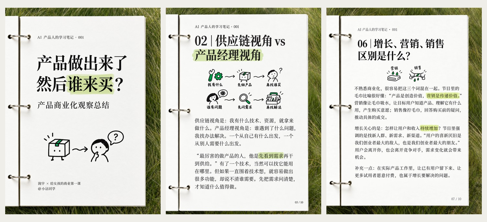
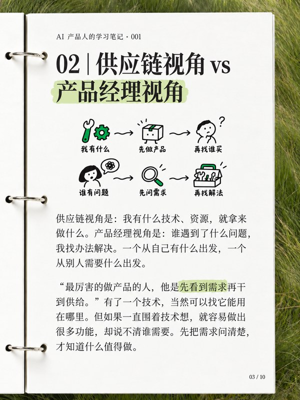
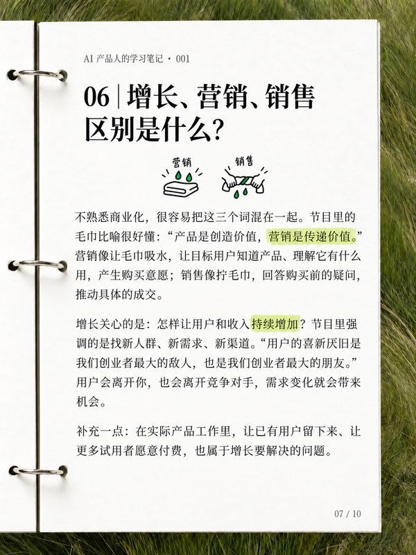

# 学习笔记套图

**把播客、文章和零散笔记，整理成一套有内容、有图解、可以发布的中文学习笔记。**

一个面向 Codex 等支持自定义技能的 AI Agent 的 Skill：从忠实整理原文开始，完成发布标题与配文、逐页正文、分页规划、整页图片生成、逐页质检及打包。适合播客学习、读书摘记、产品思考，以及小红书等平台的知识图文创作。

[快速开始](#快速开始) · [成品样例](#成品样例) · [可以得到什么](#可以得到什么) · [风格与定制](#风格与定制) · [技能入口](SKILL.md)

## 成品样例

默认风格是 **3:4 竖版活页学习笔记**：象牙白纸、草地背景、银色三环、宋体文字、浅绿色马克笔高亮，以及帮助理解内容的极简手绘图解。



| 封面 | 对比图解页 | 长正文页 |
| --- | --- | --- |
| [](references/example-01-cover.png) | [](references/example-03-comparison.png) | [](references/example-07-dense-copy.png) |
| 用主标题与概念图引出问题 | 用两条路径讲清不同思路 | 正文优先，缩小插图保留完整内容 |

点击单张图片可查看原图。以上三张来自同一套播客学习笔记，展示封面、对比与长正文版式；样例中的主题、署名和页码仅属于该项目，新任务按实际内容决定页数。

## 可以得到什么

- **完整文案**：发布标题、开头配文、逐页标题与正文，区分直接引文、转述和编辑补充。
- **成套图片**：按数字排序的封面及内页，统一风格，每页围绕一个明确主题。
- **制作记录**：实际生成与返修提示词、参考图用途、制作进度及待核对问题，便于中断后继续。
- **交付清单**：发布顺序、最终图片与文案；按需要提供 ZIP。

制作过程会先保存完整文案，再生成图片。已确认的正文不会为了排版擅自删改；正文较多时优先缩小插图或拆页。

## 快速开始

### 1. 安装技能

以 Codex 为例，将仓库克隆到技能目录：

```bash
git clone https://github.com/cinderzhan/study-note-carousel.git ~/.codex/skills/study-note-carousel
```

如果设置了 `CODEX_HOME`，可使用 `$CODEX_HOME/skills/study-note-carousel`。目标目录已存在时，请先检查内容，避免覆盖自己的修改。安装后按所用客户端的方式刷新技能列表或开启新会话。

其他支持自定义 Skill 的 Agent，可将仓库放入对应技能目录，保留根目录的 [SKILL.md](SKILL.md)、[agents/](agents/) 与 [references/](references/) 的相对位置。

### 2. 准备素材和图片生成能力

提供播客逐字稿、文章正文、可访问链接或已有笔记，并说明希望面向的读者。不可访问的链接需要补充正文；技能不会凭标题编造来源内容。

**运行环境需要提供可用的图片生成工具。** 技能默认按内置 imagegen 的规范执行，本仓库不包含图片生成模型或独立生成服务。是否需要登录、额度或 API key，由所用工具决定；仅克隆本仓库不会获得图片生成能力。

### 3. 直接调用

技能的中文展示名称是 **学习笔记套图**。在支持按描述匹配技能的客户端中，可以直接说：

```text
请使用「学习笔记套图」技能，把这篇文章整理成一套中文学习笔记图片，署名为 @你的名字。
```

用于安装目录和精确调用的技能标识保留为 `study-note-carousel`，遵循 Codex 的小写英文、数字与连字符命名约定。支持 `$技能标识` 的客户端可按下面的方式调用；中文名称能否直接匹配取决于客户端。

```text
使用 $study-note-carousel，把下面这份播客逐字稿做成一套学习笔记。
沿用默认活页本风格，面向 AI 产品经理，署名改为 @你的名字。
先保存完整文案，再生成封面与内页；页数按内容决定。
把图片、发布文案、提示词和制作进度保存到当前项目。

素材：
[在这里粘贴逐字稿或文章正文]
```

也可以带上具体要求：

```text
使用 $study-note-carousel，把这篇文章做成 6 张以内的读书笔记。
系列名为「每周阅读」，主色沿用浅绿，保留原文的重要限定条件。
引用请标明来源，自己的理解单独写成编辑补充。
```

## 从素材到交付

1. **整理内容**：读取材料，提炼主旨、观点与例子，核对引用和出处。
2. **规划分页**：写发布文案与逐页正文，按阅读顺序安排封面和内页。
3. **生成图片**：使用统一风格和本页实际文案，逐张或小批次生成，并保存提示词与进度。
4. **逐页核对**：检查错字漏字、引文归属、图解关系、文字越界、页码与留白，针对具体问题返修。
5. **整理交付**：按页序命名图片，附文案、提示词、发布顺序和制作进度。

交付目录示例（页数按项目调整）：

```text
学习笔记/
├── 01-封面.png
├── 02-主题一.png
├── 03-主题二.png
├── …
├── 发布文案.md
├── 发布顺序.txt
├── 生成提示词.txt
└── 制作进度.md
```

## 风格与定制

| 项目 | 默认设置 | 可调整内容 |
| --- | --- | --- |
| 画幅与场景 | 3:4 竖版、活页纸、草地、银色三环 | 按任务指定画幅或视觉要求 |
| 文字 | 左对齐宋体标题、细宋体正文、简体中文 | 标题层级、正文密度与分页 |
| 重点与图解 | 浅绿半透明块状高亮、黑线手绘概念图 | 高亮词、图解关系、配色 |
| 系列信息 | 系列行、期数、来源与署名 | 全部可替换或省略 |
| 署名 | `@小沾同学` | 使用时改成自己的署名 |
| 页数 | 随内容决定 | 可以提出目标页数或上限 |

## 使用说明

- 图片生成中的中文仍可能出现错字、漏字或排版问题，需要逐页对照已保存文案核查；尺寸检查不能代替文字检查。
- 长内容可拆页，不能靠删除已确认的内容来挤进固定版式。
- 参考图用于学习视觉与排版，新任务应替换主题、来源、署名和正文。
- 本技能负责制作与交付；发布到小红书等平台由使用者自行完成。

## 仓库内容

| 文件 | 用途 |
| --- | --- |
| [SKILL.md](SKILL.md) | 技能入口与完整制作流程 |
| [agents/openai.yaml](agents/openai.yaml) | Agent 展示与调用配置 |
| [references/layout-quality.md](references/layout-quality.md) | 布局规则与逐页质量检查 |
| [references/prompt-template.md](references/prompt-template.md) | 图片提示词模板与制作记录规范 |
| [references/examples.md](references/examples.md) | 三张完整样例及版式使用说明 |
| [docs/images/](docs/images/) | README 使用的轻量预览图片 |

欢迎通过 [Issues](https://github.com/cinderzhan/study-note-carousel/issues) 提交使用反馈、版式建议和具体问题；反馈图片问题时，附上对应页面、预期文案和实际效果会更方便定位。
